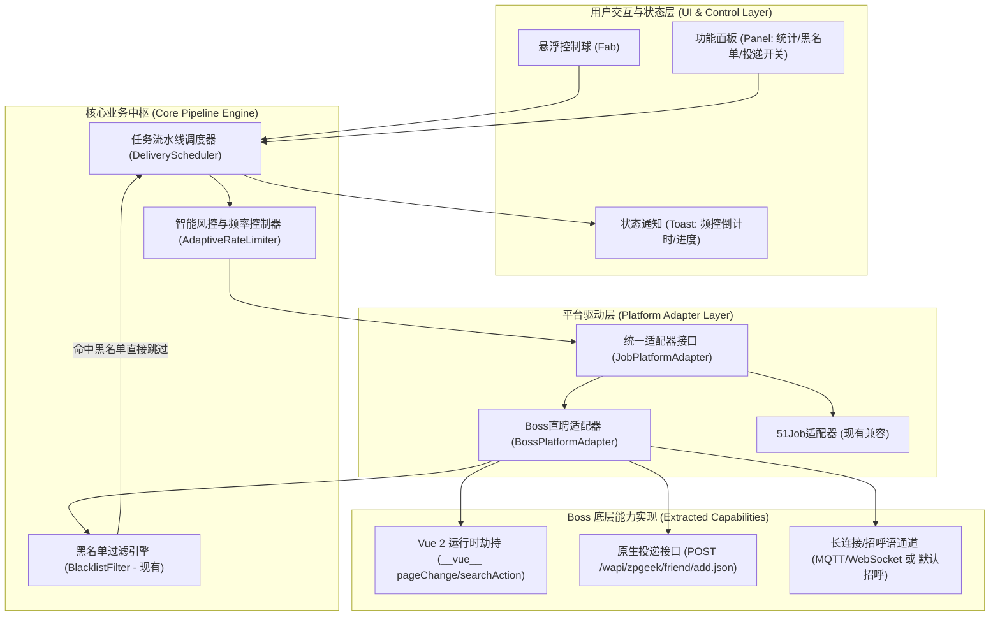

# BOSS直聘自动化模块融合重构计划 (DESIGN_DOC.md)

**文档版本**：v1.0.0 (Architecture Blueprint - Plan Only)  
**设计负责人**：Google Staff Architect  
**目标主体**：[dddd56656/job-helper](https://github.com/dddd56656/job-helper)  
**能力抽取源**：[Ocyss/boss-helper](https://github.com/Ocyss/boss-helper)  

---

## 1. 整体架构设计

### 1.1 目标运行架构模型

为保持 `job-helper` 原有的轻量、零外部重度依赖及油猴脚本原生生态优势，我们采用**分层驱动与适配器架构 (Adapter-Driven Pipeline Architecture)**。将 boss-helper 抽取的 DOM 监听与请求能力封装为平台特异性适配器，通过核心调度器统一编排。



---

### 1.2 统一适配器接口设计 (`JobPlatformAdapter`)

在 `job-helper` 内部抽象标准化接口，未来可无缝拓展其他求职平台（如猎聘、智联等）：

```typescript
/**
 * 岗位原始元数据接口
 */
interface RawJobItem {
    id: string;               // 岗位唯一标识 (encryptJobId)
    securityId: string;       // 加密安全凭证
    jobName: string;          // 岗位名称
    companyName: string;      // 公司全名 (用于黑名单匹配)
    hrName?: string;          // HR姓名
    salaryDesc?: string;      // 薪资范围
    cityDistrict?: string;    // 工作区域
    contacted: boolean;       // 是否已沟通
    rawNode?: HTMLElement;    // 对应的 DOM 卡片节点 (用于高亮或打标签)
}

/**
 * 投递结果数据结构
 */
interface DeliveryResult {
    success: boolean;
    status: 'delivered' | 'skipped_blacklist' | 'skipped_contacted' | 'rate_limited' | 'quota_exhausted';
    message: string;
    job: RawJobItem;
}

/**
 * 平台通用适配器标准契约
 */
interface JobPlatformAdapter {
    /** 平台标识 */
    readonly platformKey: string;

    /** 检查当前页面是否适配该平台 */
    isMatched(): boolean;

    /** 初始化页面上下文与 Hook */
    initContext(): Promise<void>;

    /** 刷新并获取当前页岗位列表 (返回标准化岗位项) */
    refresh_jobs(): Promise<RawJobItem[]>;

    /** 执行切页操作 (利用底层原生能力) */
    next_page(): Promise<boolean>;

    /** 获取当前页码信息 */
    get_page_info(): { current: number; total?: number; hasMore: boolean };

    /** 执行单笔/批量投递 (建立沟通) */
    batch_deliver(jobs: RawJobItem[], options: DeliveryOptions): Promise<DeliveryResult[]>;

    /** 发送自定义打招呼语 */
    batch_greet(job: RawJobItem, greetingText?: string): Promise<boolean>;
}
```

---

## 2. 模块迁移清单

### 2.1 从 `boss-helper` 抽取的函数与模块

| 抽取的代码/模块 | 原文件位置 | 提取内容与职责 | 改造策略 |
| :--- | :--- | :--- | :--- |
| **`useHookVueFn` & `useHookVueData`** | [src/composables/useVue.ts](file:///C:/Users/root/orca/projects/remoteHelper/workspace/reference/boss-helper/src/composables/useVue.ts#L35-L96) | 监听与调用 `#wrap .page-job-wrapper` 等容器的 `__vue__` 属性 | 去除 Vue3 Ref 依赖，改写为原生 Promise/Callback 函数 |
| **`sendPublishReq`** | [src/entrypoints/boss/requests.ts](file:///C:/Users/root/orca/projects/remoteHelper/workspace/reference/boss-helper/src/entrypoints/boss/requests.ts#L44-L113) | `POST /wapi/zpgeek/friend/add.json` 发送投递请求，处理 120/150 限额 | 改为轻量原生 `fetch`，依赖 Cookie 自动传递凭证 |
| **`convertBossZpJobItemToJobData`** | [src/entrypoints/boss/index.ts](file:///C:/Users/root/orca/projects/remoteHelper/workspace/reference/boss-helper/src/entrypoints/boss/index.ts#L65-L85) | 解析 Boss 原始接口数据中的 `securityId`、`encryptJobId`、`brandName` | 精简为内部 `parseBossJobItem` 函数 |
| **限额确认上报** | [src/entrypoints/boss/requests.ts](file:///C:/Users/root/orca/projects/remoteHelper/workspace/reference/boss-helper/src/entrypoints/boss/requests.ts#L83-L90) | `POST /wapi/zpCommon/actionLog/geek/chatremind.json` 自动解锁 120 人限制 | 封装为 `confirmLimitPopup` 辅助函数 |

---

### 2.2 在 `job-helper` 中新增/改造的架构组织

采用**模块化脚本架构**（开发态支持多文件拆分，构建态可打包或内嵌至单文件油猴脚本中）：

```
job-helper/
├── src/
│   ├── core/
│   │   ├── blacklist.js          # [改造] 升级黑名单逻辑：支持前置同步判定与快速比对
│   │   ├── scheduler.js          # [新增] 核心投递流水线调度器（支持队列、重试与熔断）
│   │   └── rate_limiter.js       # [新增] 拟人化随机延时器 (Jitter Random Delay)
│   ├── platforms/
│   │   ├── adapter_interface.js  # [新增] 平台适配器抽象基类
│   │   ├── boss_adapter.js       # [新增] 融合抽取的核心 Boss 直聘适配器 (Vue Hook + API)
│   │   └── job51_adapter.js      # [改造] 现有 51Job 兼容逻辑抽离
│   ├── ui/
│   │   ├── fab.js                # [改造] 悬浮球：增加投递中状态指示与一键急停
│   │   └── panel.js              # [改造] 控制面板：增加批量投递配置（间隔、招呼语、投递总数上限）
│   └── index.js                  # 入口组装与生命周期初始化
└── job-helper.user.js            # 打包生成的生产单文件油猴脚本
```

---

## 3. 风险与防御机制 (Risk & Anti-Ban Strategy)

针对 Boss 直聘严密的前端与网关级风控，构建四道防御纵深：

1. **拟人化时间微扰动 (Jittered Timing)**：
   - **单次投递间隔**：基准 3 秒 + 随机高斯抖动（1.5s ~ 4.5s）。
   - **翻页浏览间隔**：模拟真实用户翻页浏览，切页后强制缓冲等待 10 ~ 25 秒。
   - **随机休眠**：每投递 10 个岗位后，强制休眠 30 秒（“假装休息”）。
2. **硬性配额与阈值熔断机制 (Hard Quota Circuit Breaker)**：
   - **单日上限控制**：设置自定义上限（默认 80~100 次/天，低于官方 120/150 硬封顶）。
   - **异常状态码拦截**：一旦接口返回 `code: 1` 且包含“操作过于频繁”或网络 403，**立即终止整个流水线并声音/Toast告警**，禁止任何后续请求。
3. **黑名单零请求前置跳过 (Zero-Request Pre-filtering)**：
   - 在触发 `batch_deliver` 遍历时，首要执行 `Storage.isBlocked(job.companyName)`。
   - 命中黑名单的公司直接打上标签跳过，**绝不向服务端发起任何 HTTP 请求**，既保护用户配额，又避免频繁触发无效请求。
4. **原生凭证保活与环境安全**：
   - 不篡改 Header 或伪造指纹，100% 复用浏览器当前已登录会话中的 `bst` Cookie 和用户原生 User-Agent。

---

## 4. 渐进式实施步骤 (Staged Atomic Tasks)

为确保工程质量，后续代码落地严格划分为 5 个原子任务，单步执行、单步验证：

### Task 1: 基础设施与黑名单前置引擎改造
- **目标**：重构 `Storage` 与黑名单比对逻辑，提供供流水线调用同步过滤接口；搭建核心工程目录骨架。
- **改动文件**：`src/core/blacklist.js`, `src/core/rate_limiter.js`
- **依赖前提**：阶段零创建的 `feat/boss-blacklist-filter` 分支。
- **完成判据 (Acceptance Criteria)**：
  - 黑名单支持 O(1) 毫秒级命中匹配；
  - 随机延时器支持配置区间内的防特征抖动延时测试通过。

### Task 2: Boss 运行时 Vue Hook 与精准翻页抽取
- **目标**：从 `boss-helper` 完整抽取 `useHookVueFn` / `useHookVueData`，实现对 Boss 直聘 Vue 实例的接管，替代原版的假元素滚轮滚动。
- **改动文件**：`src/platforms/boss_hooks.js`, `src/platforms/boss_adapter.js`
- **依赖前提**：Task 1 完成，分支 `feat/boss-pagination-refresh`。
- **完成判据 (Acceptance Criteria)**：
  - 在控制台或测试页面中，调用 `BossAdapter.refresh_jobs()` 能稳定拉取当前页完整原始岗位列表；
  - 调用 `BossAdapter.next_page()` 能无感切页并自动捕获新一页数据，翻页成功率 100%，无卡死。

### Task 3: 投递网络请求与限额熔断机制移植
- **目标**：抽取 `sendPublishReq` 接口及 120/150 限额识别与自动确认请求。
- **改动文件**：`src/platforms/boss_api.js`
- **依赖前提**：Task 2 完成，分支 `feat/boss-batch-greet`。
- **完成判据 (Acceptance Criteria)**：
  - 封装的 `deliverJob(securityId, jobId)` 能正确发起投递；
  - 遇到限额能抛出结构化错误对象，并能正确触发自动确认请求。

### Task 4: 流水线调度器与 UI 控制面板融合
- **目标**：实现 `DeliveryScheduler`，将【翻页 -> 黑名单过滤 -> 频控等待 -> 投递/打招呼 -> 翻页】串联为闭环，并在 UI 面板上增加投递控制开关、计数器和状态展示。
- **改动文件**：`src/core/scheduler.js`, `src/ui/panel.js`, `src/ui/fab.js`
- **依赖前提**：Task 1, 2, 3 完成。
- **完成判据 (Acceptance Criteria)**：
  - UI 拥有“开始批量投递”、“暂停”、“黑名单跳过数”、“今日已投递数”等完整展示与控制；
  - 点击“暂停”或悬浮球能瞬间挂起流水线。

### Task 5: 全链路联调、构建单文件脚本与 E2E 验证
- **目标**：将所有模块聚合到 `feat/boss-integration-pipeline` 分支，打包生成生产 UserScript，并进行端到端场景验证与 `git diff` 审查。
- **改动文件**：`src/index.js`, `job-helper.user.js`
- **依赖前提**：Task 4 完成。
- **完成判据 (Acceptance Criteria)**：
  - 在真实 Boss 直聘页面运行，脚本能自动翻页、自动跳过黑名单企业、批量投递并自动带出招呼语；
  - `git diff` 清晰呈现模块化改动。

---

## 🚨 核心执行门禁与审查要求

> [!CAUTION]
> **当前状态**：方案编制完成，已写入设计规范文档。
> **严格门禁**：按照既定约束，**坚决不输出任何业务落地代码**。
> 请审阅本方案。只有当你发出明确指令（例如：“**批准 Task 1，开始编写代码**”）时，我们才在对应分支开启单步代码落地！
